# Forecast terminology and SewerCast review evidence

All screenshots are **real local Chromium renders with synthetic fixture data**, not current beach conditions or production forecasts. Earlier iterations are retained for review; **05-final-stage3** is the first Stage 3 iteration; **06-combined-sewer-copy** is the current UI. No account pages, credentials, or private user data are included. `docs/**` is excluded from the Vercel function bundle.

## Current behavior

- Water Quality Forecast preserves Stage 4: same-day mapped discharge risk plus lingering effects. Other bacteria causes are outside scope; scores are not calibrated contamination probabilities or lab measurements.
- SewerCast reads additive `stage3_zones` from the existing `Composition.s3.zone_p` for the selected corrections mode. The four canonical zones and existing max-of-mapped-link aggregation are unchanged. Stage 2 basin probabilities and Stage 4 scores are never substituted. Old cached payloads show unavailable until a normal refresh supplies the new field.
- Model Check: “Learn how the model works and see how its predictions compare with what happened.” Existing controls, observed day-by-day records, gauge rainfall, discharge volumes/sources, watcher badges and sample links remain accessible. `#cso` and `#check` remain intact.
- Today headlines are unchanged. Its supporting link is now: **“SewerCast shows same-day discharge impact risk by beach zone.”** `/forecast#cso`.

## Fixtures and verification

Final forecast fixture: Stage 3 ocean/baker_china/north/east = 42/25/0/8%, plain = 21/15/0/4%; Stage 4 = 80% (plain 70%); basin probabilities = 30% (plain 12%). These deliberately different values catch accidental substitutions. Partial fixture retains only ocean=0; null and string values are unavailable. Missing fixture has no Stage 3 field in either mode. The beach-status feed is empty intentionally. Desktop width 1440px; mobile width 390px. Final captures include the full page.

Today before/after uses the same safe-status fixture and Stage 4 scores 80/30/20/10%, rising to 90% tomorrow, with forecast expanded. Map tile imagery is omitted in both. Baseline is pushed commit `1886941`. Earlier Today “after” still links to basin likelihood; final Today “after” uses beach-zone impact risk. Final “before” is a repeated matched baseline capture.

Passed: served-model golden suite (all prior values/hashes retained, no re-pinning), compose_v2, live_rules, new Stage 3 payload-path tests, Today, landing, About, risk levels, sample popovers and stage builder. Browser checks cover desktop/mobile layout, corrections on/off, valid zeros, missing/partial data, empty response, deep links, model controls, historical comparisons/observations and sample links, with no JavaScript errors. Some offline page tests log unavailable external feeds; assertions pass.

The golden comparison excludes only the new additive field from old nested pins; all pre-existing values remain checked to the original tolerance. No model files, training, numerical rules, or database schema/data are changed.

## Screenshot inventory

The initial diagnostics are cropped viewports and may begin mid-page; they are historical diagnostic captures, not final review images. The original SewerCast name preview still has the earlier Water Quality Forecast shared header and basin view. Audit captures introduce the separate headers but still show basin probabilities. No requested image was missing from the available local inventory.

### 01-initial-diagnostics

[forecast-cso-mobile.png](01-initial-diagnostics/forecast-cso-mobile.png) (390 × 844)

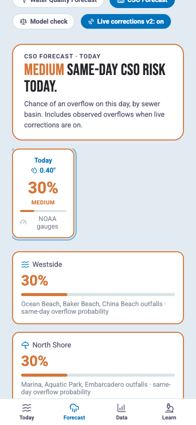

[forecast-observations-desktop.png](01-initial-diagnostics/forecast-observations-desktop.png) (1280 × 900)

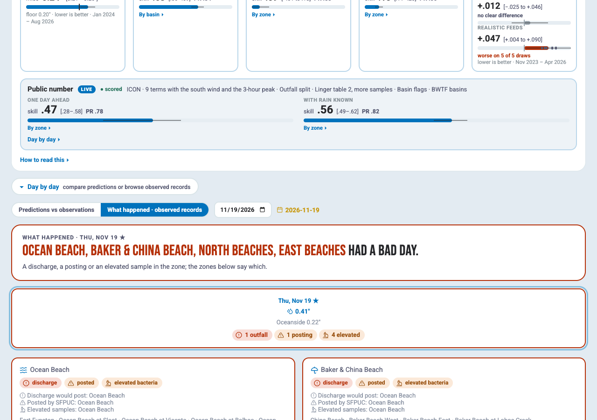

[forecast-observations-mobile.png](01-initial-diagnostics/forecast-observations-mobile.png) (390 × 844)

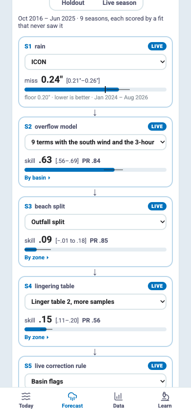

### 02-sewercast-name-preview

[SewerCast-desktop.png](02-sewercast-name-preview/SewerCast-desktop.png) (1440 × 1100)

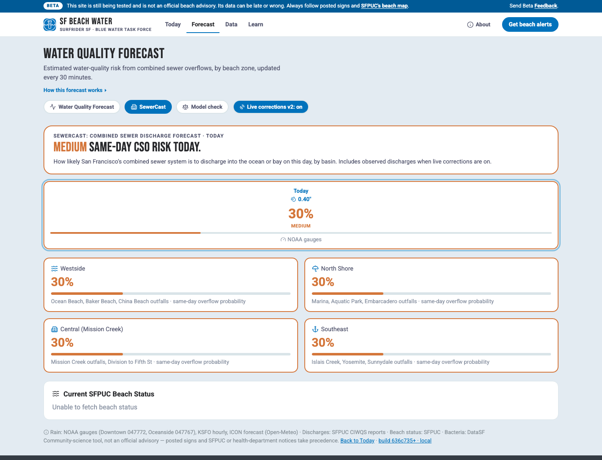

[SewerCast-mobile.png](02-sewercast-name-preview/SewerCast-mobile.png) (390 × 1000)

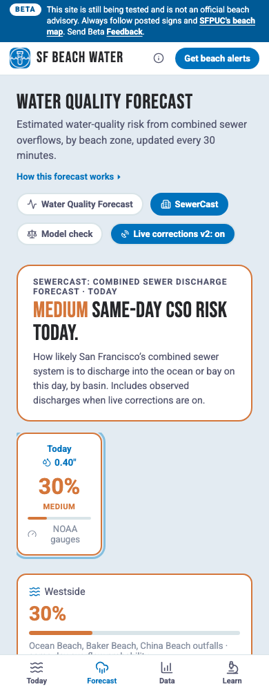

### 03-terminology-layout-audit

[Audit-SewerCast-desktop.png](03-terminology-layout-audit/Audit-SewerCast-desktop.png) (1440 × 1100)

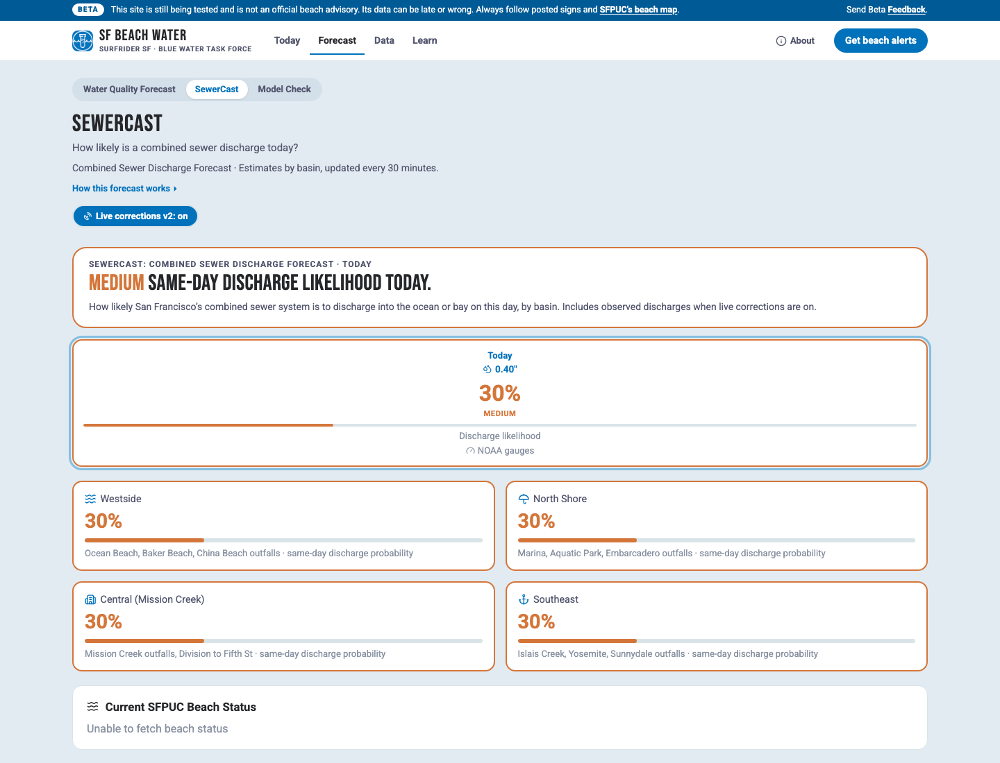

[Audit-SewerCast-mobile.png](03-terminology-layout-audit/Audit-SewerCast-mobile.png) (390 × 1000)

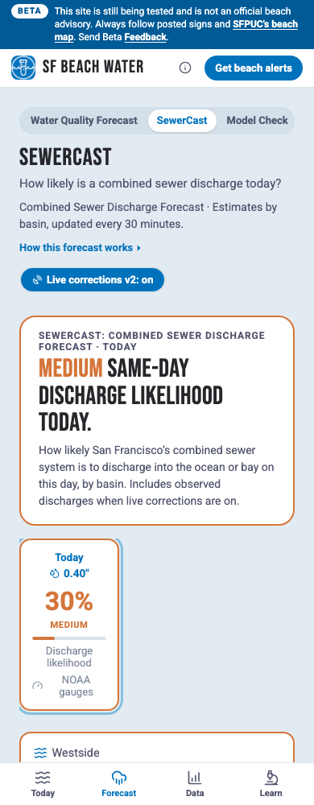

[Audit-model-check-desktop.png](03-terminology-layout-audit/Audit-model-check-desktop.png) (1440 × 1100)

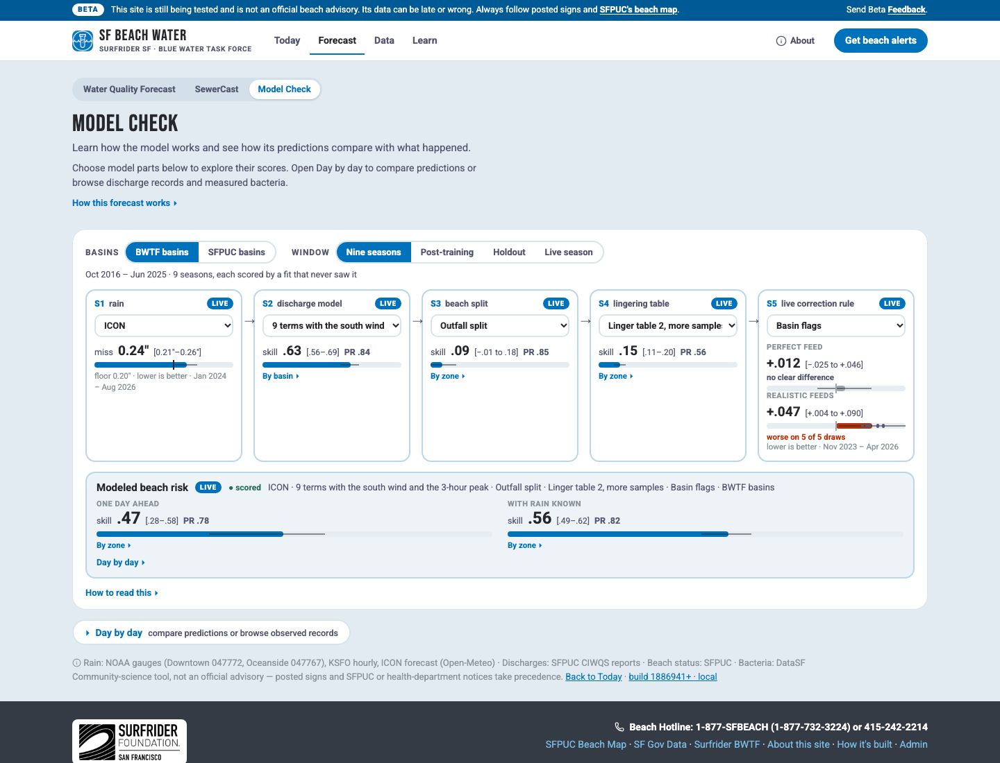

[Audit-model-check-mobile.png](03-terminology-layout-audit/Audit-model-check-mobile.png) (390 × 1000)

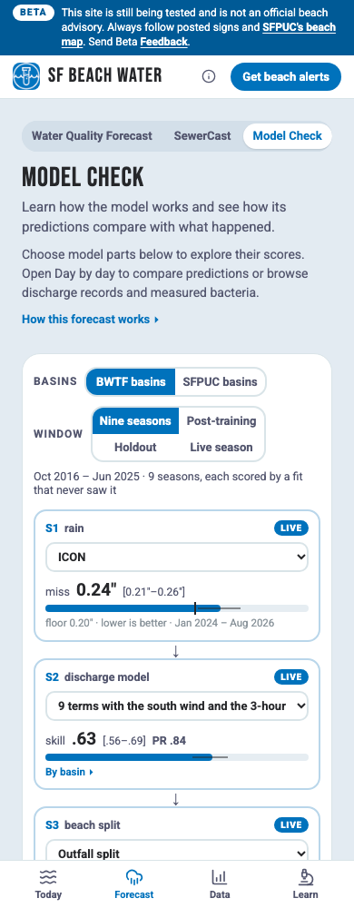

[Audit-water-quality-desktop.png](03-terminology-layout-audit/Audit-water-quality-desktop.png) (1440 × 1100)

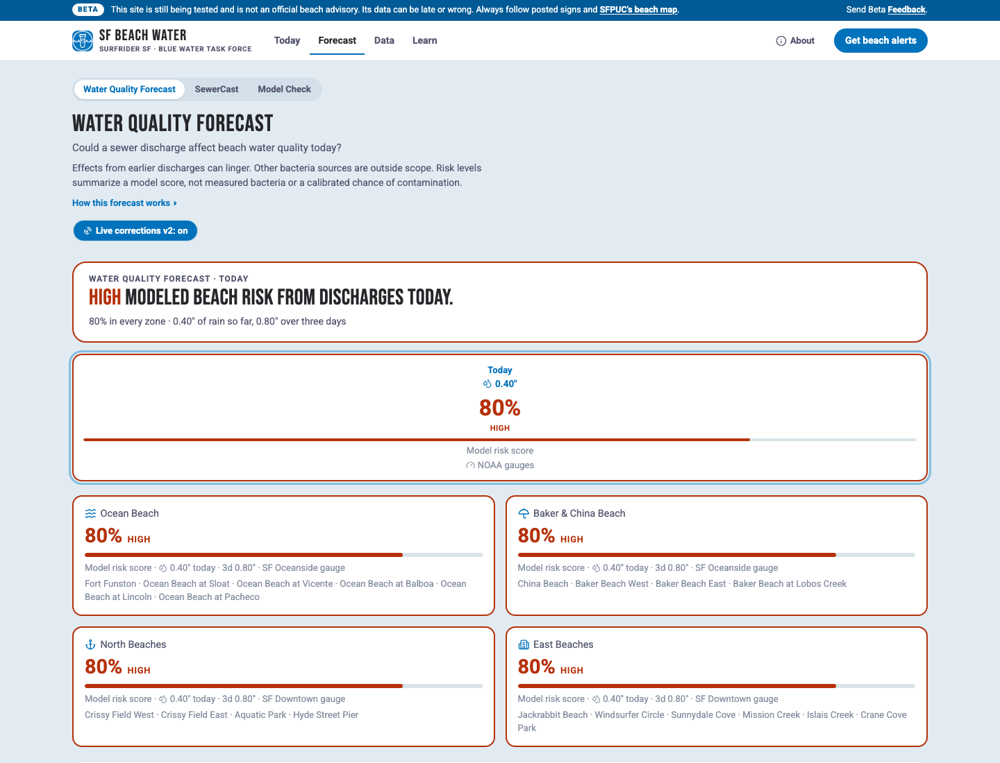

[Audit-water-quality-mobile.png](03-terminology-layout-audit/Audit-water-quality-mobile.png) (390 × 1000)

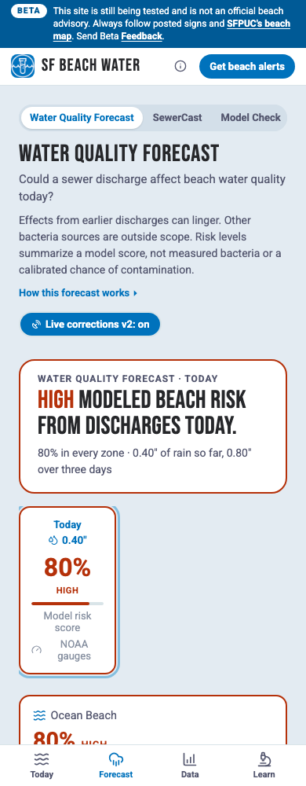

### 04-today-before-after

[Today-expanded-after.png](04-today-before-after/Today-expanded-after.png) (1280 × 758)

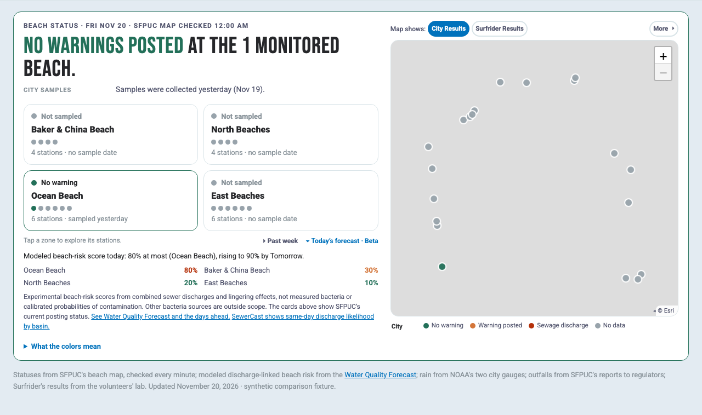

[Today-expanded-before.png](04-today-before-after/Today-expanded-before.png) (1280 × 722)

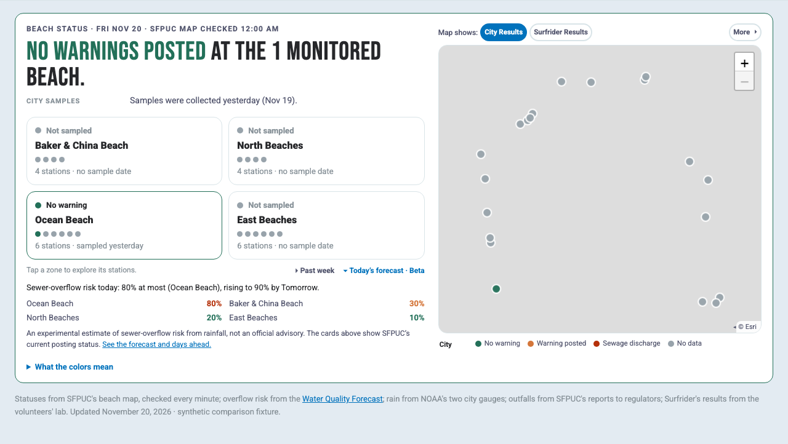

### 05-final-stage3

[Final-Stage3-SewerCast-desktop.png](05-final-stage3/Final-Stage3-SewerCast-desktop.png) (1440 × 1525)

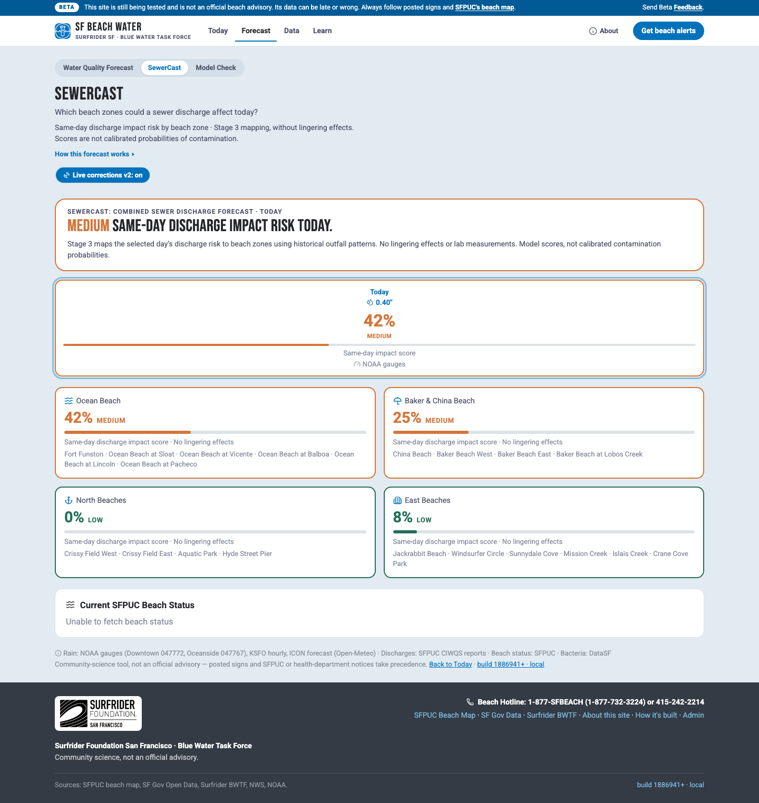

[Final-Stage3-SewerCast-mobile.png](05-final-stage3/Final-Stage3-SewerCast-mobile.png) (390 × 2575)

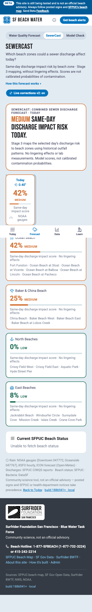

[Final-Stage3-missing-mobile.png](05-final-stage3/Final-Stage3-missing-mobile.png) (390 × 2502)

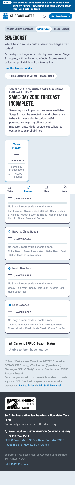

[Final-Stage3-model-check-desktop.png](05-final-stage3/Final-Stage3-model-check-desktop.png) (1440 × 1240)

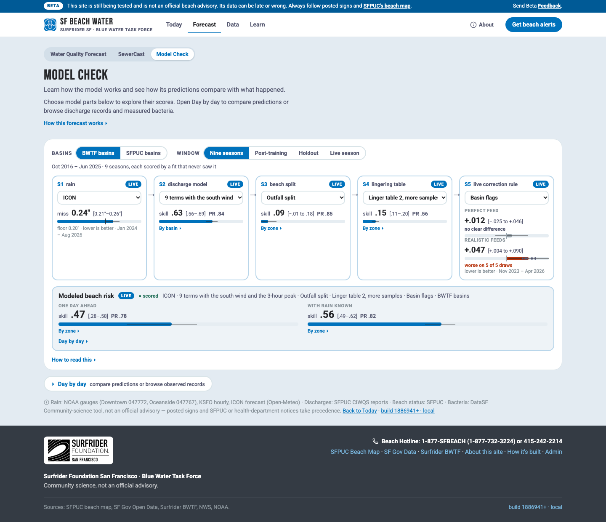

[Final-Stage3-model-check-mobile.png](05-final-stage3/Final-Stage3-model-check-mobile.png) (390 × 2528)

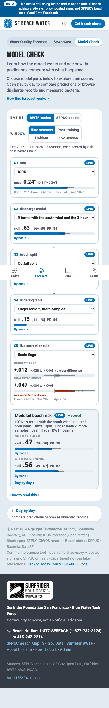

[Final-Stage3-partial-mobile.png](05-final-stage3/Final-Stage3-partial-mobile.png) (390 × 2517)

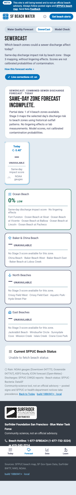

[Final-Stage3-water-quality-desktop.png](05-final-stage3/Final-Stage3-water-quality-desktop.png) (1440 × 1504)

[Final-Stage3-water-quality-mobile.png](05-final-stage3/Final-Stage3-water-quality-mobile.png) (390 × 2485)

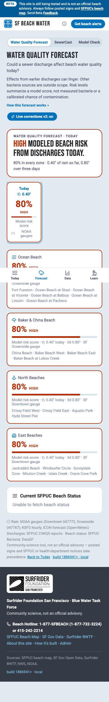

[Final-Today-expanded-after.png](05-final-stage3/Final-Today-expanded-after.png) (1280 × 758)

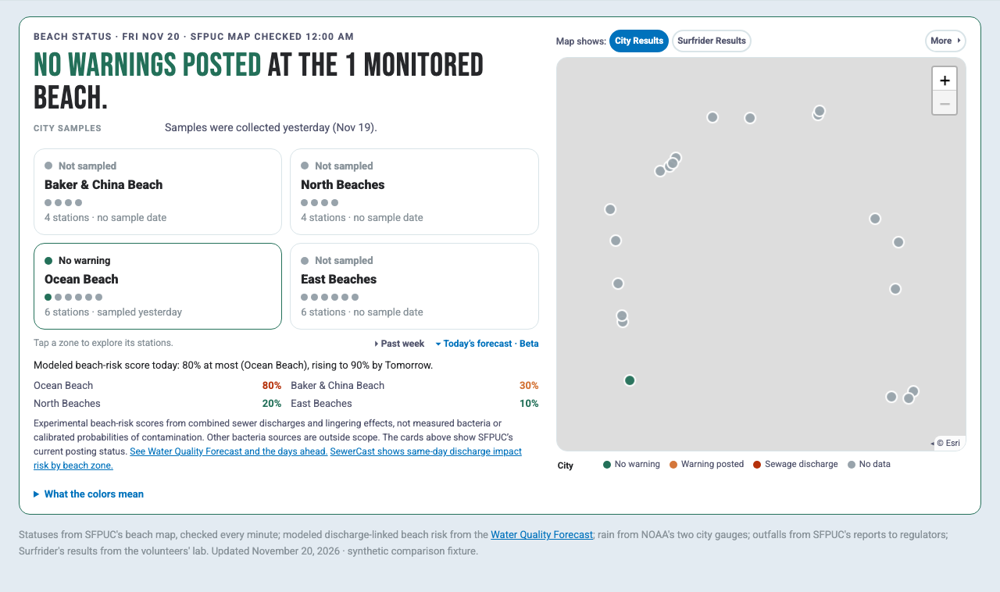

[Final-Today-expanded-before.png](05-final-stage3/Final-Today-expanded-before.png) (1280 × 722)

## Follow-up: combined sewer wording and unavailable preview

Current intro: “Which beach zones could be affected by a combined sewer discharge today?” Nearby copy uses combined sewer discharge consistently.

Read-only snapshot inspection on 2026-11-20 found the shared snapshot generated at 06:35 UTC (about 11 minutes old) contained six Stage 4 forecast days and zero Stage 3 fields in either corrected or plain payloads. The handler serves shared snapshots younger than three hours before loading the preview engine. Production's older code cannot emit the new field, so its routine refresh will not fix this preview mismatch. No refresh jobs, cache writes, database mutations or production changes were performed.

The cached day keys also lack expected event-volume inputs used by Stage 3's size-dependent mapping. Basin probabilities and Stage 4 results do not provide an exact fallback. The UI therefore retains unavailable rather than inventing scores. Review Stage 3 using the synthetic fixtures below; live review needs an isolated preview data source or a separately authorized production release.

The previous text said “Same-day zone forecast incomplete.” It was not a “complete” status. Missing scores now say “Same-day impact scores are unavailable.” and explain that the supplied snapshot lacks usable Stage 3 scores; reloading the page cannot add them. Partial coverage says “Some beach-zone scores are unavailable.” and gives the available zone count.

A regression fixture verifies the legacy snapshot path returns unchanged data without loading the engine or issuing update/RPC writes. Existing Stage 3 tests and desktop/mobile browser checks pass. All captures below are synthetic fixtures, including missing/partial states.

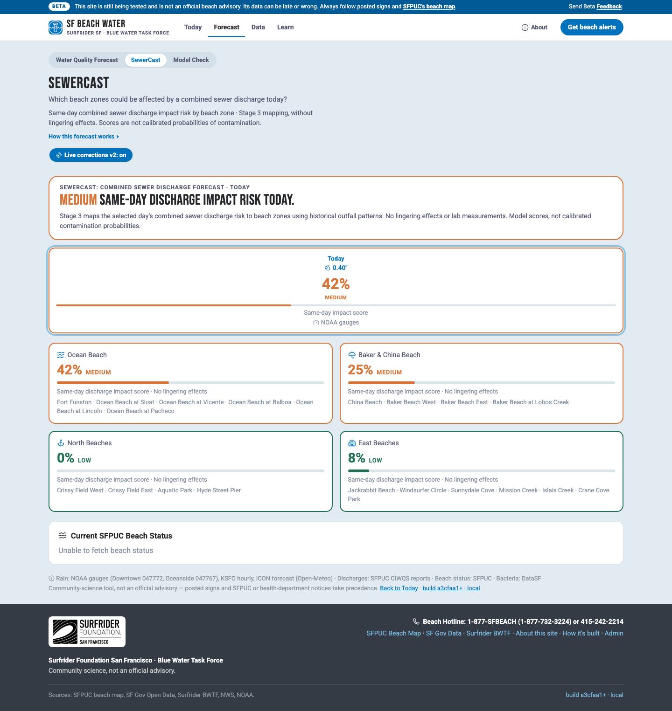

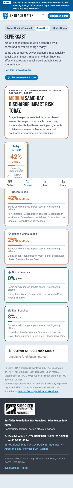

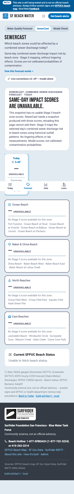

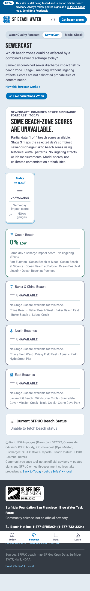

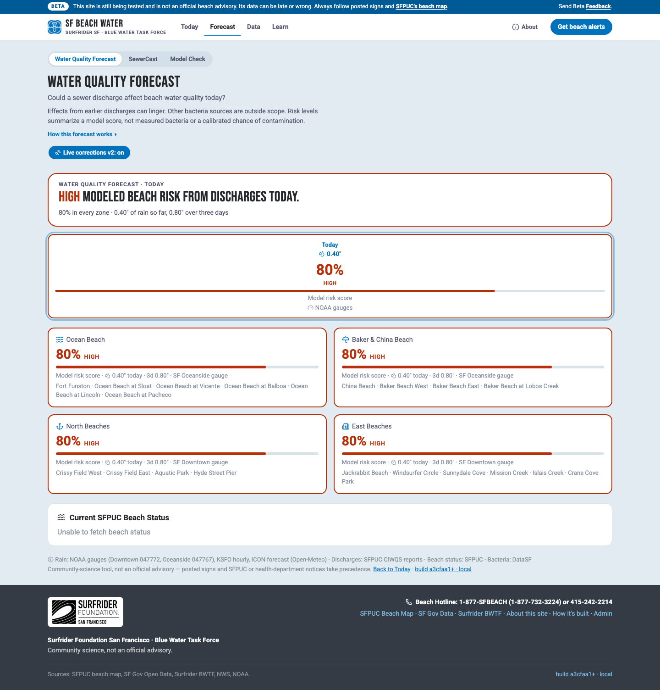

